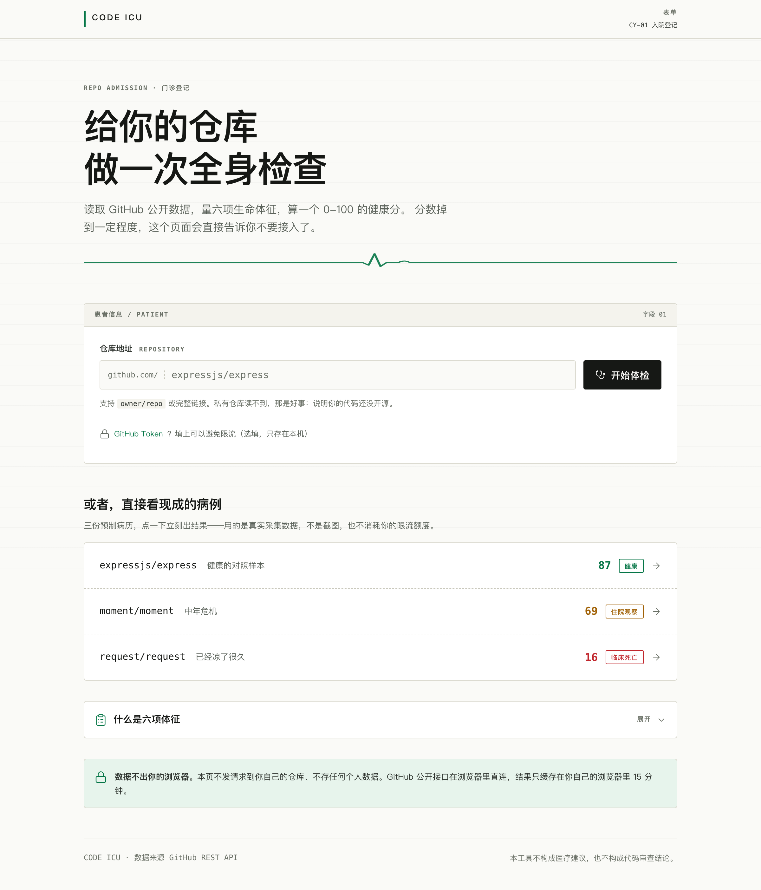
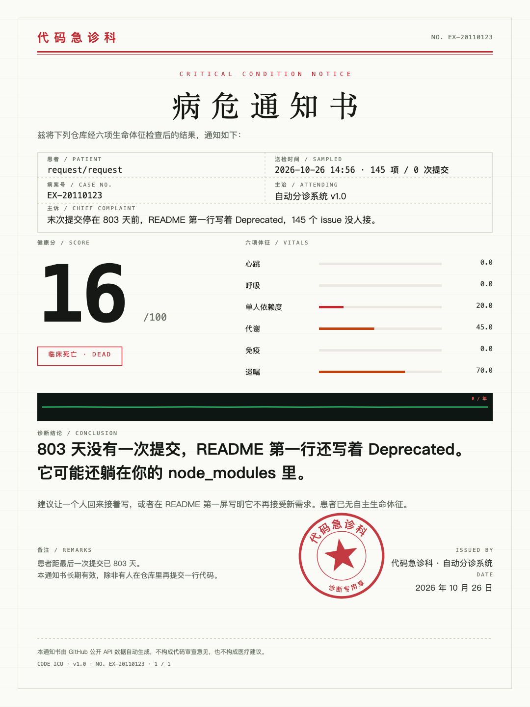

# Code ICU · 代码急诊科

> 把 GitHub 仓库当成一个病人做全身体检，六项体征打分，最后下一张《病危通知书》。

一个输入框、一次体检、一张可以发朋友圈的死亡证明。所有数字都来自 GitHub 公开 API，每一条都能点开看是怎么算出来的——**不做假数据演示**。

在线体验：<https://gztcode.github.io/code-icu/>



---

## 它解决什么问题

接手一个陌生仓库之前，你真正想知道的是：

- 这项目**还活着吗**？最后提交是什么时候？
- 会不会**随时崩**？只有一个作者在维护吗？
- 有没有**接手成本**？一堆没人管的 issue 挂着？
- 还能**信它**吗**？文档、发布、演进记录是不是都停更了？

Code ICU 把这四个问题翻译成六个可以量化、可以解释、可以复算的「生命体征」，并给出一个 0–100 的健康分和五档分诊结论。

## 六项体征

| 体征 | 权重 | 看什么 | 怎么算的 |
|---|---|---|---|
| **心跳** | 25% | 近 12 个月提交活跃度与趋势 | 提交频率 + 环比趋势 |
| **呼吸** | 20% | 代码库的「呼吸量」 | 年化提交数，120 次/年 满分 |
| **单人依赖度** | 20% | bus factor | 非 bot 提交者的集中度，1 人独撑则重罚 |
| **免疫** | 15% | 抗病能力 | 未关闭 issue 数与僵尸 issue（>90 天未更新）比例 |
| **代谢** | 10% | 新陈代谢 | release 发版频率与版本间隔 |
| **遗嘱** | 10% | 遗产完备度 | README 完整度、字数、关键章节 |

**加权总分** → 0–100 健康分 → 五档分诊：

| 健康分 | 结论 | 一句话 |
|---|---|---|
| ≥ 85 | 健康 HEALTHY | 各项体征平稳，可放心接入 |
| ≥ 70 | 门诊随访 FOLLOW-UP | 存在需要关注的老化信号 |
| ≥ 50 | 住院观察 ADMITTED | 多项体征恶化，接手前需评估成本 |
| ≥ 30 | ICU CRITICAL | 危重，除维护外不建议新接入 |
| < 30 | 临床死亡 DEAD | 已无生命体征，仅作史料 |

### 年龄归一化（重要）

直接用「一年」做绝对分母，会把刚开源的新项目系统性判死刑：2 个月 40 次提交，年化是 240 次的健康密度，却只拿到 43 分；2 个月的单人开发会被判成「过度集中」。

所以每项体征都按项目**实际存在月数**归一化（`ageMonths = (now - created_at) / (30.44 天)`）：

- 满 12 个月以上的成熟项目：算法一分不动，与直觉一致
- 不足 12 个月：分母按真实月数折算
- 不足 3 个月（婴儿期）：免疫项**弃权**、遗嘱给保底分——README 还没写完是正常的
- 统计窗口不足的项直接弃权，权重由剩余项重新归一化，而不是硬给一个低分

弃权项会在页面上明确标出「本项数据不足，未计入总分」，而不是悄悄给 0 分。

## 功能

- **一个输入框**：`owner/repo`、完整 URL、带 `.git` 后缀都认
- **一键示例**：内置 3 个不同健康度的真实仓库，点即出结果
- **体检中**：分步进度展示实时调用的 5 个 API 端点
- **报告页**：六项体征详单 + ECG 提交趋势波形 + 寿命推演 + 处置建议
- **病危通知书**：独立视图 + Canvas 2D 导出 1080×1440 PNG，带印章
- **深链分享**：`#/r/owner/repo` 直接把报告发给同事
- **三态齐全**：加载中 / 404 / 限流 / 网络失败，都不白屏
- **快照兜底**：断网或限流时降级到预置快照，并明确标注「演示数据」
- **可选 Token**：填入 PAT 后限流从 60/h 提升到 5000/h

<p align="center">
  
</p>

<p align="center">
  
</p>

## 技术选型

**零构建、零运行时依赖、原生 ES Module。**

| 决策 | 理由 |
|---|---|
| 原生 ESM，不用打包器 | `src/` 直接就是产物，克隆即可跑。`package.json` 只声明开发期工具（Playwright），**运行时零依赖** |
| Hash 路由 | GitHub Pages 子目录部署零配置，不需要服务端 rewrite |
| 浏览器直连 GitHub API | GitHub REST API 已实测 `access-control-allow-origin: *`，无需代理层，**没有后端就没有后端故障** |
| 5 个端点并行 | 串行 5×200ms 太慢，并行后单请求墙钟时间 ≈ 单个最慢请求 |
| 系统字体栈 | 不引 Google Fonts CDN——国内访问会挂起到超时，且 Canvas 导出字形会与设计稿分叉 |
| 设计 Token 用 CSS 变量 | 主题色由 `main.js` 从 Token 读出后写入 `<meta theme-color>`，避免色值散落 |

### 数据来源

全部来自 GitHub 公开 REST API，无自建数据库、无埋点、无用户数据上传：

| 端点 | 用途 |
|---|---|
| `/repos/{slug}` | 仓库档案（创建时间、star、fork、license） |
| `/repos/{slug}/commits?since=…` | 近 12 个月提交（心跳 / 呼吸 / bus factor） |
| `/repos/{slug}/releases` | 发版记录（代谢） |
| `/repos/{slug}/issues?state=open` | 未关闭 issue（免疫） |
| `/repos/{slug}/readme` | README 完整度（遗嘱） |

Token 只存在浏览器 `localStorage`，只用于给 `api.github.com` 请求加 `Authorization` 头，不经过任何第三方。

## 安装与使用

四种用法，按省事程度从高到低排。

### 1. 在线版（零安装）

<https://gztcode.github.io/code-icu/>

浏览器打开即用，手机也能开。数据实时来自 GitHub API。

### 2. 装成桌面应用（PWA）

Chrome / Edge 打开上面的地址 → 地址栏右侧的「安装」图标 → 装完得到一个独立窗口的应用：

- 独立窗口，没有浏览器地址栏
- 桌面/开始菜单有图标，双击直接进
- **断网也能打开**（Service Worker 缓存了全部站点资源）

macOS Safari：分享 → 添加到程序坞。　iOS Safari：分享 → 添加到主屏幕。

### 3. 下载桌面包（离线可跑）

Releases 页面：<https://github.com/gztcode/code-icu/releases>

| 包 | 适用系统 | 怎么用 |
|---|---|---|
| `code-icu-<版本>-macos.zip` | macOS | 解压后双击 `start.command` |
| `code-icu-<版本>-windows.zip` | Windows | 解压后双击 `start.bat` |
| `code-icu-<版本>-linux.zip` | Linux | 解压后运行 `bash start.sh` |
| `code-icu-<版本>-web.zip` | 任意 | 纯站点文件，扔进任意静态服务器 |
| `code-icu-<版本>-source.zip` | 任意 | 完整源码 |

启动脚本会自动挑可用运行时（优先 Node.js，没有就用 Python 3），起一个本地服务并打开浏览器。关闭那个命令行/Terminal 窗口即停止服务。

> **为什么不能直接双击 `index.html`？**
> 页面用原生 ES Module。Chrome / Safari 在 `file://` 下会以 CORS 为由拒绝加载模块脚本（origin 为 null），页面直接白屏。所以必须起一个 HTTP 服务，启动脚本已经替你做了。

完整说明见 [`docs/INSTALL.md`](docs/INSTALL.md)。

### 4. 本地开发

```bash
git clone https://github.com/gztcode/code-icu.git
cd code-icu

npm install     # 运行时零依赖，这一步只装测试用的 Playwright
npm start       # 起本地服务 → http://127.0.0.1:8080
npm test        # 跑五套回归
```

其他脚本：

```bash
npm run icons      # 重新生成 PWA 图标（src/icons/）
npm run pack       # 打包三平台发行包到 dist/
npm run test:online  # 打线上地址做端到端冒烟
```

> 本地起服务请用 `npm start`（即 `node tests/serve.mjs`）。
> **不要用 `python3 -m http.server`** —— 它的监听队列只有 5，而本页一进来要并行拉
> 30+ 个 ES Module，队列溢出会让内核 RST 掉排在后面的连接，浏览器表现为
> 「随机一个模块 `ERR_CONNECTION_RESET`」，页面白屏且时好时坏。
> 实测 12 次连续加载里白屏 6 次。发行包内置的 `serve.py` 已把队列放大到 128，
> 同样条件下 12 次加载 0 失败。

## 测试

五套回归，共 **423 项**，覆盖算法正确性、UI 结构、外链安全、印章像素与 Token 链路（含真实网络层）：

```bash
node tests/verify.mjs        # 79 项 · 纯逻辑与工具函数
node tests/young-cases.mjs   # 80 项 · 年龄归一化与快照基线
node tests/ui-check.mjs     # 226 项 · DOM 结构、链接、触控目标
node tests/stamp-check.mjs   # 20 项 · DOM 与 Canvas 印章文字对撞（像素级）
node tests/token-check.mjs   # 18 项 · Token 读写与真实 API 限额
```

UI 与印章测试需要 Playwright：

```bash
npm i playwright && npx playwright install chromium
```

线上冒烟测试直接打真实部署地址，验证部署链路本身（资源可达、路由可用、PNG 可导出、无 JS 错误、PWA 与离线可用，共 23 项）：

```bash
node tests/online-smoke.mjs https://gztcode.github.io/code-icu/
```

发行包冒烟测试则解压桌面包、起本地服务器、用真实浏览器验证 PWA 能力（manifest / Service Worker / 缓存 / 交互），共 12 项：

```bash
npm run pack && node tests/package-smoke.mjs
```

## 部署与发布

| 触发 | 产物 | 位置 |
|---|---|---|
| 推送 `main` | 站点部署到 GitHub Pages | <https://gztcode.github.io/code-icu/> |
| 推送 `v*` tag | 三平台压缩包 + Release | <https://github.com/gztcode/code-icu/releases> |

两条流水线都是 `.github/workflows/` 下的 GitHub Actions，全程零构建：

- `deploy.yml` —— 发布站点 + 部署后自动冒烟（校验 19 个关键资源与首页内容）
- `release.yml` —— 校验 tag 与 `package.json` 版本号一致 → 打包 → 抽查包结构 → 创建 Release 并上传资产

本地手动打包：

```bash
npm run pack      # 产物落在 dist/，同时给出每个包的 SHA-256
```

站点地址：<https://gztcode.github.io/code-icu/>

## 项目结构

```
src/                    站点产物根目录（GitHub Pages 发布的就是它）
  index.html            单页入口 + 内联 SVG 图标 sprite
  manifest.webmanifest  PWA 清单（可安装为桌面应用）
  sw.js                 Service Worker（network-first + 离线兜底）
  icons/                PWA 图标（192 / 512 / maskable / apple-touch）
  css/                  tokens / app / app-flow / app-report / app-notice
  js/
    config.js           权重、阈值、示例仓库、缓存键（唯一的魔法数字收口处）
    metrics.js          六项体征算法
    vitals.js           体征派生数据
    http.js             GitHub API 封装（含 owner 字段与安全裁剪）
    dom.js              DOM 助手 + safeUrl 外链白名单校验
    router.js           Hash 路由
    views/              home / report / notice
    components/         patient / vital-card / score-ring / ecg / timeline ...
    share/stamp.js      Canvas 印章与通知书导出
design/                 设计稿、设计 Token、图标清单、社媒对比图
tests/                  六套测试 + 快照夹具
  verify / young-cases / ui-check / stamp-check / token-check   回归
  online-smoke.mjs       打真实线上地址的端到端冒烟
  package-smoke.mjs      解压发行包后的离线冒烟
tools/                  打包与工具脚本
  pack-release.mjs       三平台发行包打包
  make-icons.mjs         PWA 图标生成（Playwright 渲染 SVG）
  server.mjs             零依赖本地静态服务器（Node 版）
  launcher/              各平台启动脚本 + serve.py + 包内说明模板
docs/SPEC.md             完整规格：算法、阈值、分级表、范围锁定
docs/INSTALL.md          安装说明
docs/decisions/          ADR（架构决策记录）
```

## 参赛

WorkBuddy「1024 造物挑战」② Code ICU。截稿 2026-11-01。

## License

[MIT](LICENSE) © 2026 gztcode

本项目采用 MIT 许可证。你可以自由地使用、复制、修改、合并、发布、分发、再许可与销售本软件的副本，唯一的条件是：在所有副本或实质性部分中保留版权声明与许可声明。

软件按「原样」提供，不附带任何形式的明示或暗示担保，包括但不限于对适销性、特定用途适用性与不侵权性的担保。

**本项目与 GitHub、GitHub 商标无关，非 GitHub 官方作品。** 所有体检数据均来自 GitHub 公开 REST API，「体检」「病危通知书」等表述仅为比喻性的产品设计，不构成对任何仓库健康状况的专业评价。

本项目参赛 WorkBuddy「1024 造物挑战」。算法完全公开，欢迎查看源码复核。
